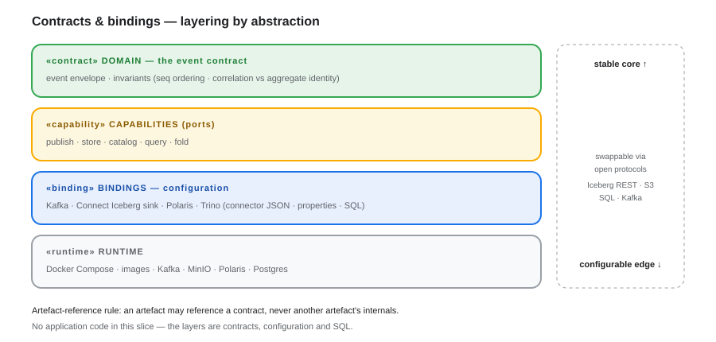
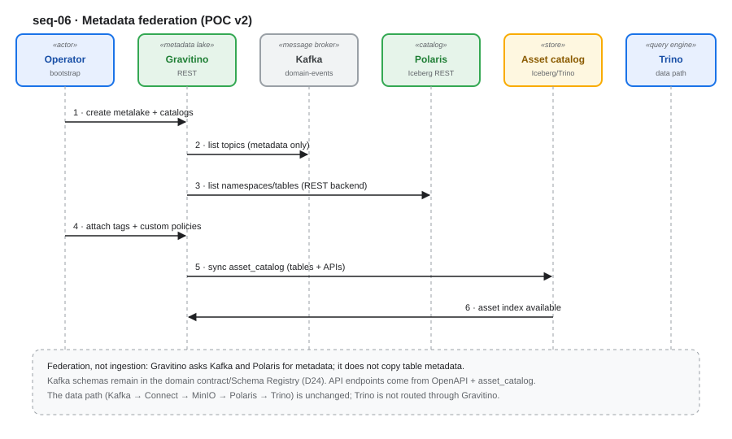
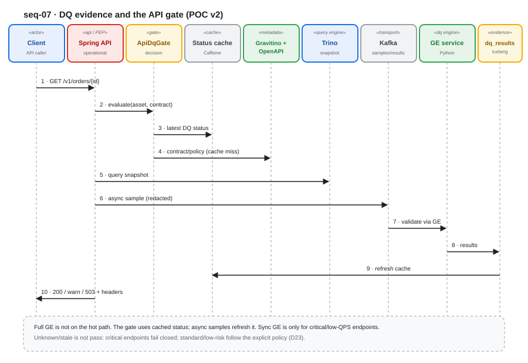

# Event Hub → Iceberg → Trino — an architecture decision instrument

**Can domain events on a message bus be landed as an open Iceberg table on object storage, catalogued by a REST catalog, and served through Trino — without writing any storage, catalog or query-engine code? And once that path exists, what is the *minimum* metadata, contract, data-quality and API-enforcement control plane that can sit around it?**

This repository is a working proof of concept that answers both questions with measured evidence rather than assertion. The data path is **config-defined (codeless)** — connector JSON, SQL, and REST/CLI calls only. The control plane adds a deliberately bounded code carve-out: one Spring Boot API that acts as the policy enforcement point, and one Python Great Expectations service. Everything else is a third-party product.

It is a **decision instrument, not a demo** (D11): the plumbing is commodity, so the repository exists to settle the choices that are not — hot view vs. system of record, self-hosted vs. managed, metadata federation vs. a unified governance platform, and whether API-boundary data-quality enforcement can be bought or must be built.


| | |
|---|---|
| **Invariant** | The open table format + REST-catalog contract — Iceberg + a REST catalog (D1). Trino is the default engine, not the constant. |
| **Data plane** | Kafka → Kafka Connect Iceberg sink → MinIO → Polaris → Trino. No bespoke writer, no hand-written Iceberg metadata. |
| **Control plane (POC v2)** | Gravitino metadata federation · OpenAPI registry + `asset_catalog` · Trino SQL and Great Expectations DQ · Iceberg `dq_results` · Spring `ApiDqGate` |
| **Runtime** | 10 services on Docker Compose — 7 on the `data` profile, 3 more on `full` |
| **Evidence** | T11–T16 pass · **T17 blocked** · deferred items listed in [Status and known gaps](#status-and-known-gaps) |

## Contents

| Section | What it answers |
|---|---|
| [Purpose](#purpose) | Why this exists, and the two POC generations |
| [Architecture](#architecture) | Layering, data plane, control plane, freshness model |
| [What the POC proves](#what-the-poc-proves) | G1–G11 mapped to artefacts and verdicts |
| [Findings](#findings) | Twelve observations that each forced a decision |
| [Status and known gaps](#status-and-known-gaps) | What passes, what is blocked, what is deferred |
| [How to run](#how-to-run) | Prerequisites, profiles, ports, the validated run order |
| [Non-goals](#non-goals) | What this deliberately does not do |
| [Repository map](#repository-map) | What lives where |
| [Documentation index](#documentation-index) | The architecture documents and ADR log |
| [Security notes](#security-notes) | Committed keys and spike-only code |

---

## Purpose

Domain events arrive from Event Hub (Kafka, JSON, domain-model payload). The organisation wants a lakehouse it can leave, not another warehouse it cannot. That sets two separate problems:

1. **The data path.** Can events be landed as an open table with catalog-owned atomicity, correct replay semantics, time travel, and *measured* freshness — using only third-party components?
2. **The control plane.** Once the bytes are trustworthy, what does it take to know which assets exist, what contract they honour, whether their quality is acceptable, and to *stop* an API response when it is not?

**POC v1** answers the first question and produces the build-vs-buy / hot-view-vs-record decision inputs (G1–G6).
**POC v2** answers the second, additively — it does not replace Polaris, Trino, the sink or the event contract (G7–G11).

Both generations are documented as contracts first: the domain event contract, the capabilities required, the products bound to them, and the runtime that hosts them.

---

## Architecture

### Contract-first layering

The data path has no application code, so the layers are **contract boundaries, not code modules**. Substitutability comes from open protocols, not interfaces in Java.



| Layer (directory) | The stable contract | Bound by (configuration) | Substitutable via |
|---|---|---|---|
| **Domain** (`poc/domain/`) | event envelope + invariants (`seq` ordering, correlation vs. aggregate id) | — (specification) | any producer honouring it |
| **Capabilities** (`poc/application/`) | publish · store · catalog · query · fold | capability definitions | — |
| **Bindings** (`poc/adapters/`) | which product implements each capability | connector JSON, properties, SQL | Iceberg REST · S3 API · SQL · Kafka |
| **Runtime** (`poc/infrastructure/`) | the deployed components | compose file, image tags | any conforming product |

**Artefact-reference rule** (the codeless analogue of the dependency rule): an artefact may reference a *contract*, never another artefact's internals. Runtime configures bindings; bindings provide capabilities; capabilities rely on the event contract.

`poc/domain/`, `poc/application/` and `poc/adapters/` are documentation-only. Code exists in exactly two places — `poc/operational-api/` and `poc/dq/gx-service/` — as a bounded carve-out (D22) for the `enforce` and `observe` capabilities, which cannot be delivered by configuration alone.

### Data plane

```text
Event Hub (Kafka, JSON)
   │
   ▼
Kafka Connect + Iceberg sink ──▶ MinIO (Parquet + Iceberg metadata)
   │                                        │
   │                              Polaris (Iceberg REST catalog)
   │                                        │
   └────────────▶ Trino (Iceberg connector) ◀┘
                        │
                        ▼
              SQL fold (MERGE) ──▶ snapshot_order
```


| Component | Stereotype | Role | Product |
|---|---|---|---|
| Event Hub | external system | publishes domain events | simulated by `kcat` / Connect source |
| Kafka (KRaft) | message broker | event transport, topic `domain-events` | `apache/kafka` |
| Kafka Connect + Iceberg sink | binding | writes and **commits** Iceberg tables | Connect 8.0 + Iceberg 1.12.0 (built from source) |
| MinIO | object store | data files, manifests, table metadata | `bitnamilegacy/minio` |
| Polaris | catalog | atomicity boundary, REST catalog, token broker | `apache/polaris` |
| Postgres | metastore | Polaris `relational-jdbc` state | `postgres:16` |
| Trino | query engine | retrieval, fold, DQ execution | `trinodb/trino` (483) |

Three consequences are load-bearing, and each is a recorded decision:

- **The catalog owns the commit** (D3, D7). The sink coordinates table commits through Polaris; no process in this repository writes Iceberg metadata by hand.
- **The event log is the source of truth; snapshots are derived and disposable** (D4). A snapshot can always be rebuilt from the log, which is what makes replay and correction cheap.
- **The fold is SQL and the snapshot table is the contract** (D3). The default fold is a Trino `MERGE` keyed on `seq > version`, so a replayed event cannot regress a row.


### Control plane (POC v2)

The control plane is **additive**. It reads the data plane through each product's own contract and writes only its own evidence table.



| Capability | Contract | Bound by (product) | Realised as |
|---|---|---|---|
| **Govern** | assets, tags, policies, contracts | Apache Gravitino + OpenAPI registry | `poc/infrastructure/config/gravitino/`, `poc/metadata/api/openapi.yaml` |
| **Observe** | DQ checks and evidence | Trino SQL + Great Expectations | `poc/sql/04_data_quality_checks.sql`, `poc/dq/gx-service/` |
| **Enforce** | API decision (allow / warn / block) | Spring Boot `ApiDqGate` (PEP) | `poc/operational-api/` |
| **Evidence** | DQ history | Iceberg `dq_results` | `poc/sql/05_create_dq_results.sql` |
| **Transport** | async samples/results | Kafka | `api-dq-samples`, `dq-results` (planned) |



The enforcement model is deliberately narrow: an endpoint is classified `CRITICAL`, `STANDARD` or `LOW_RISK`, and the decision is **per endpoint class, not global** (D23). The POC implements the `CRITICAL` path — fail closed — and returns the decision in headers rather than HTTP bodies:

| Request | Response | `X-DQ-Status` |
|---|---|---|
| Healthy order | `200` | `pass` |
| Invalid order (`?scenario=bad`, test-only hook) | `503` | `fail` |
| Nonexistent aggregate (empty response) | `503` | `fail` |
| GE service stopped | `503` | `unknown` |

A gate that fails open on a DQ outage is worse than no gate, so `UNKNOWN` is treated as `fail` for `CRITICAL` endpoints. `STANDARD` and `LOW_RISK` policies are designed and configured but not exercised: the POC has one endpoint.

### Freshness model

Freshness is a measured SLO, not an assumption (D6). Staleness decomposes into three additive terms:


| Term | Controlled by | POC value |
|---|---|---|
| Commit interval | `iceberg.control.commit.interval-ms` | 15 000 ms |
| Metadata cache TTL | Trino Iceberg connector | default |
| Planning and execution | Trino | sub-second |

Measured end-to-end: **7 s** from produce to visible in Trino under a 15 s commit interval, with the worst case bounded by the commit interval plus one poll cycle. This is the number an SLO has to be written against; it is not a property of Iceberg.

### Diagram index

Sequence diagrams live in `poc/docs/diagrams/` (participants labelled by stereotype and product):

| Diagram | Flow |
|---|---|
| [`layer-contracts-and-bindings.svg`](poc/docs/diagrams/layer-contracts-and-bindings.svg) | contract · capability · binding · runtime |
| [`seq-01-event-ingestion.svg`](poc/docs/diagrams/seq-01-event-ingestion.svg) | event ingestion |
| [`seq-02-catalog-commit.svg`](poc/docs/diagrams/seq-02-catalog-commit.svg) | atomic catalog commit |
| [`seq-03-snapshot-materialisation.svg`](poc/docs/diagrams/seq-03-snapshot-materialisation.svg) | snapshot materialisation |
| [`seq-04-aggregate-retrieval.svg`](poc/docs/diagrams/seq-04-aggregate-retrieval.svg) | retrieval by correlation id |
| [`seq-05-replay-recovery.svg`](poc/docs/diagrams/seq-05-replay-recovery.svg) | replay and recovery |
| [`seq-06-metadata-federation.svg`](poc/docs/diagrams/seq-06-metadata-federation.svg) | metadata federation (v2) |
| [`seq-07-dq-gate.svg`](poc/docs/diagrams/seq-07-dq-gate.svg) | DQ evidence and the API gate (v2) |
| [`aggregation-bake-off.svg`](poc/docs/diagrams/aggregation-bake-off.svg) | hot view vs. record (two-store pattern) |

The broader architecture set — 22 diagrams covering positioning, on-ramps, use cases, the decision matrix and the modern target — is in [`docs/diagrams/`](docs/diagrams/).

---

## What the POC proves

Each goal is stated with the artefact that realises it and the verdict recorded in the wave results. Verdicts reflect what was actually observed, including where the evidence is weaker than the goal.

| # | Goal | Artefact | Verdict |
|---|---|---|---|
| **G1** | Events land end-to-end through third-party components only | `poc/infrastructure/`, `poc/infrastructure/config/kafka-connect/iceberg-sink.json` | ✅ 10 events produced → `events_kafka` = 10 rows, `event_id`/`seq` intact |
| **G2** | Retrieve an aggregate snapshot keyed by `correlation_id` | `poc/sql/02_query_by_correlation.sql`, `poc/sql/03_build_snapshot.sql` | ✅ 4 stitched events returned in `seq` order; `MERGE` → 2 snapshot rows (`order-123` v3 · Paid, `order-999` v1) |
| **G3** | The catalog commit is the atomicity boundary; no hand-written metadata | Connect sink + Polaris | ✅ commit visible with no refresh; MinIO holds data, manifests and **two** `metadata.json` versions; `events$snapshots` shows both commits |
| **G4** | Freshness is measured, not assumed | `iceberg.control.commit.interval-ms` + Trino | ✅ produce → queryable in **7 s** at a 15 s commit interval |
| **G5** | A reusable contract-first layer map | `poc/domain/`, `poc/application/`, `poc/adapters/` | ✅ documented; static scan for a hand-rolled Iceberg writer found **0** executable matches |
| **G6** | Hot view vs. record and build vs. buy | `poc/docs/05-aggregation-bake-off.md` | ⬜ **framework only** — decision criteria, scorecard and the four possible outcomes are documented; no ClickHouse hot view is implemented here, so the two-store divergence is not measured |
| **G7** | Metadata federation across Kafka and Polaris without copying | `poc/infrastructure/config/gravitino/` | ✅ metalake `poc` federates the Kafka topics and the Iceberg schema/tables live; no second metadata store |
| **G8** | Contracts and tags for data *and* API assets; policies for data assets | `poc/metadata/api/openapi.yaml`, `asset_catalog`, Gravitino bootstrap | ✅ 5 tags (`domain`, `pii`, `dq_tier`, `freshness_class`, `api_exposure`) and 3 policies attached with verified inheritance; API contract versioned as `orders-api-v1` |
| **G9** | DQ across Trino and the API | `poc/sql/04_data_quality_checks.sql`, `poc/dq/gx-service/` | ✅ 8 data checks execute against latest state; GE is deterministic on good / bad / empty payloads |
| **G10** | API-boundary enforcement | `poc/operational-api/` | ✅ `200/pass`, `503/fail`, `503/unknown` (fail closed); mismatched contract version → no suite → fail closed |
| **G11** | Decide hybrid metadata plane (Hybrid A vs. Hybrid B) | decision log D25, `docs/metadata-and-data-quality-options.md` | ✅ evidence gathered (live federation, tag/policy inheritance, both DQ paths, gate latency, coverage gaps); **Hybrid A adopted for the POC, Hybrid B retained as the production evaluation** |

Two results are worth reading as findings rather than gates: the data-quality run produced a **real failing check** (`events.freshness`, 591 922 s against a 300 s threshold) because the seeded events were a week old — useful proof that a stale dataset produces a failing gate input rather than a silent pass. And the connector's idempotency survived a restart with **10 → 10 rows**, which is the property that makes replay safe.

## Findings

Twelve observations from building and running the stack. Each one cost time, and each one changed a decision — which is the reason the repository is worth keeping.

**F1 · Polaris's defaults silently discard the catalog.** `persistence.type` defaults to the *test-only* in-memory metastore, so every catalog, namespace, table and principal disappears on restart, and the server logs a readiness warning that is easy to miss. Polaris also never creates its own schema, and a mounted `config/polaris/application.properties` is ignored — settings must arrive as environment variables.
*Forced:* `relational-jdbc` on Postgres with the schema pre-created in `poc/infrastructure/config/postgres/init/` and a one-off Admin-Tool bootstrap (D14).

**F2 · An ephemeral token-signing key invalidates every token already issued.** By default Polaris generates a fresh RSA key pair at each start. The Kafka sink then fails with `NotAuthorizedException: Failed to verify the token` after any restart — a failure that looks like an auth bug and is actually a key-rotation bug.
*Forced:* a stable, mounted key pair, with the restart test as the acceptance criterion: a token minted before the restart still validates after it (D15).

**F3 · The Iceberg Kafka Connect sink has no published binary.** Not on Docker Hub, Maven Central, GitHub releases, or the Apache distribution — the archive is produced by the Iceberg Gradle build. Three constraints are load-bearing: the worker needs **Java 17+** (Connect 7.x runs Java 11 and rejects the classes), the jars must sit **flat** in a plugin directory rather than nested under `lib/`, and `value.converter` must be `StringConverter` because `JsonToMapTransform` parses the raw JSON itself.
*Forced:* a multi-stage `connect/Dockerfile` that builds Iceberg 1.12.0 from source (~6.5 min) onto a Java 17 Connect 8.0 worker (D13).

**F4 · MinIO's community images were removed from Docker Hub.** The reference image in every tutorial no longer resolves.
*Forced:* `bitnamilegacy/minio` — the same server, unchanged S3 API (D12). This build serves no console, so the bucket is created with `mc` inside the container.

**F5 · Gravitino's Iceberg REST backend forwards the caller's token to Polaris.** `UserPrincipalForwardingAuthManager` is forced; static catalog credentials are ignored and overwritten. Polaris JWTs carry `iss`, `sub`, `active` and `scope` but **no `aud` claim**, while Gravitino's built-in validator requires an audience.
*Forced:* a **spike-only** `PolarisTokenValidator` that checks RS256 signature, issuer and `active`, plus bootstrap scripts that obtain a Polaris token and send it as a Bearer token. Production requires an IdP or token broker issuing audience-bound tokens (D26, O14).

**F6 · In Gravitino 1.3.1, policies attach directly to objects — they are not tag-associated.** Policies inherit down the hierarchy; `TAG_VALUE` selectors belong to newer releases. Tags therefore remain pure classification.
*Forced:* direct and ancestor policy attachment in the bootstrap, and an idempotent `names_at?details=true` call so re-running the bootstrap reports "already attached" instead of failing on a duplicate key (D27).

**F7 · A Kafka Connect task can report `RUNNING` while its target state is `PAUSED`, and a post-resume commit can write zero rows.** `/status` shows neither. The consumer group was `Stable` with constant lag; `PUT …/resume` drained it, after which later batches logged "committed to 1 table(s)" while no snapshot or rows appeared. A side-by-side 8.1 worker reproduced the pause and then failed with `Coordinator unexpectedly terminated`, which points at commit/control-state handling rather than broker or payload.
*Forced:* a smoke contract on **observable effects, never on `/status`** — assert consumer lag reaches 0 *and* the row count advances by exactly one — and an open remediation item for the runbook (O15).

**F8 · `docker compose restart` with no service argument is a silent no-op when every service sits in a profile.** It exits 0, restarts nothing, and the container's `StartedAt` does not move — so a restart assertion that only compares row counts passes trivially.
*Forced:* restart the stack with `docker compose --profile data restart` (or by container id) in every test.

**F9 · Capacity is a finding, not an excuse.** On a 3.8 GB host, Connect's default heap plus Trino plus the control plane **OOM-killed Trino** (`ExitCode=137`). After a full-stack restart, Connect's plugin scan (257 jars) took ~8 minutes. A latency figure measured under that contention is not an SLO.
*Forced:* a Connect heap cap in compose, `data`/`full` profiles so the whole plane is not started by accident, and an explicit **8–16 GB** requirement for the full stack.

**F10 · A synchronous DQ gate is affordable only at low QPS.** Measured: **12.1 s cold**, **0.35–0.89 s warm** for the Spring endpoint; GE `/v1/validate` is 2.1 s cold and 0.025–0.039 s warm once loaded.
*Forced:* the POC keeps the synchronous path for a `CRITICAL`, low-QPS endpoint and records **async Kafka sampling plus a result cache** as the production target (D20, O11).

**F11 · No metadata or DQ product enforces at the API boundary.** Gravitino has no DQ engine and no API-endpoint entity; Great Expectations validates payloads but does not gate responses; custom Gravitino policies are metadata only. The gate is therefore not avoidable by buying something.
*Forced:* a thin policy enforcement point in the call path (D19) — Trino query → `ApiDqGate` → GE → `200`/`503` with `X-DQ-*` headers — with the metadata plane and the DQ engine behind it (D16–D18).

**F12 · The Gravitino UI's global `Accept` header breaks Polaris's token endpoint.** The UI sets `application/vnd.gravitino.v1+json`, Polaris answers `406 Not Acceptable`; `curl` sends no such header, so the endpoint appears healthy until a browser touches it.
*Forced:* a small nginx facade (`polaris-proxy`) that rewrites `Accept` for `/api/catalog/v1/oauth/tokens` and supplies CORS for the UI origin, while Polaris stays on the compose network and on host port 8182 for debugging (D28).

---

## Status and known gaps

### Verification status

| Test | Scope | Status |
|---|---|---|
| **T11** | Gravitino metadata federation (Kafka topics + Polaris Iceberg, no copy) | ✅ pass |
| **T12** | Tags, custom policies, inheritance | ✅ pass |
| **T13** | `asset_catalog`, `dq_results`, Trino SQL data checks | ✅ pass |
| **T14** | Great Expectations API validation | ✅ pass |
| **T15** | Spring `ApiDqGate` enforcement, fail-closed | ✅ pass |
| **T16** | Contract drift (OpenAPI version vs. GE suite version) | ✅ pass |
| **T17** | Regression/security baseline re-run of T1–T10 | ⛔ **blocked** — not a pass |

### T17 — why the baseline is blocked

The re-run hit two distinct defects, both recorded with reproduction steps:

1. **The sink task reported `RUNNING` while its target state was `PAUSED`.** Only `PUT /connectors/iceberg-events-sink/resume` cleared it; after that, one event did land. Any smoke check that trusts `/status` will report a healthy connector that is consuming nothing.
2. **Post-resume commits wrote no rows.** The coordinator logged a table commit while `events_kafka` stayed at its previous count, and a fresh topic reproduced it. A side-by-side 8.1 worker reproduced the pause, then failed with `Coordinator unexpectedly terminated`.

What *did* run: **T6** (time travel — `FOR VERSION AS OF` returned 3 rows against 8 current) and **T9** (no hand-rolled writer — zero executable matches) pass; **T1** and **T7** are partial; **T2–T5, T8 and T10** could not be completed. The remediation path is a deliberate connector/control-state reset (delete only while stopped), restart, register, resume, produce one event, then re-run the baseline on a host with 8–16 GB.

### Deferred by design

These are recorded as production targets, not silent gaps:

| Deferred | Why it matters |
|---|---|
| Async Kafka sampling → `dq-results`, plus a result cache | the synchronous gate costs 0.35–0.89 s warm on the request path |
| Persisting API DQ runs into `dq_results` | the gate returns `X-DQ-Run-Id` but does not yet write the run to Iceberg |
| `X-Data-Freshness` header, gate-decision audit, Micrometer/Prometheus metrics | observability of the enforcement point |
| mTLS between Spring and GE; PII sampling/redaction | API samples must be redacted before leaving the JVM |
| Gravitino `custom.dq.*` statistics push | latest status is not history; Iceberg remains the time series |
| Gravitino policy resolution in the request path | 1.3.1 policies are metadata only; the gate enforces the configured GE suite |
| Semantic model `order_snapshot` | the semantic layer over `snapshot_order` |
| `STANDARD` / `LOW_RISK` decision matrix | designed and configurable; the POC has one `CRITICAL` endpoint |

**Unowned in the POC, and not an oversight:** compaction, snapshot expiry and orphan-file cleanup belong to Iceberg maintenance. No component in this stack owns them; they become a scheduled maintenance task (`optimize`, `expire_snapshots`, `remove_orphan_files`) once the slice is proven.

> The per-wave evidence files (`RESULT*.md`, the data-path smoke script) live in `poc/tests/` in the working tree and are **not version-controlled in this repository**. Everything asserted above is also recorded in the architecture documents indexed below.

---

## How to run

### Prerequisites

| Requirement | Notes |
|---|---|
| Docker Engine / Desktop with **Compose v2** | validated on Docker 27.4.0 · Compose 2.31.0 · macOS |
| **8–16 GB RAM** | the full profile adds Gravitino, Great Expectations and Spring to the seven data-plane services; on a 4 GB host Trino was OOM-killed |
| ≥ 10 GB free disk | images, the Iceberg Gradle build, connector plugins |
| `curl`, `jq` | catalog bootstrap and assertions |
| Optional: `mc`, `kcat` | bucket inspection, manual event production |

```bash
cd poc/infrastructure
```

### Profiles, services and ports

| Service | Port | Profile |
|---|---|---|
| Kafka (KRaft) | 9092 | `data`, `full` |
| MinIO | 9000 (S3) · 9001 (mapped, no console in this build) | `data`, `full` |
| Postgres | internal | `data`, `full` |
| Polaris (via `polaris-proxy`) | **8181** | `data`, `full` |
| Polaris (direct, debugging) | 8182 | `data`, `full` |
| Trino | **8081** → 8080 | `data`, `full` |
| Kafka Connect | 8083 | `data`, `full` |
| Gravitino | 8090 | `full` |
| `gx-dq` (Great Expectations) | 8000 | `full` |
| `operational-api` (Spring) | 8082 | `full` |

Image tags in the compose file are indicative — **pin and verify** them for your environment.

### Data plane — POC v1

**1 · Build the connector image.** The Iceberg sink has no published binary, so the image compiles it from the Apache source tarball (~6.5 minutes, memory-hungry — stop the other JVMs first on a small host):

```bash
docker compose stop kafka polaris trino
docker compose build connect
```

**2 · Start the data plane:**

```bash
docker compose --profile data up -d      # kafka · minio · postgres · polaris · polaris-proxy · trino · connect
```

**3 · Create the warehouse bucket.** This MinIO build serves no console, so use `mc` inside the container:

```bash
docker compose exec -T minio sh -c '
  mc alias set local http://127.0.0.1:9000 minio minio123 &&
  mc mb --ignore-existing local/warehouse'
```

**4 · Bootstrap the Polaris metastore once.** This creates the tables *and* the realm/principal in Postgres; the schema itself is pre-created by `./config/postgres/init/01-polaris-schema.sql`:

```bash
docker run --rm --network infrastructure_default \
  --env polaris.persistence.type=relational-jdbc \
  --env quarkus.datasource.jdbc.url="jdbc:postgresql://postgres:5432/polaris?currentSchema=polaris_schema" \
  --env quarkus.datasource.username=polaris --env quarkus.datasource.password=polaris \
  apache/polaris-admin-tool:latest bootstrap -r POLARIS -c POLARIS,root,secret
```

**5 · Create the catalog through the Management API** (the Iceberg REST path has no create-catalog operation). The creating principal is the one that can use the catalog, which is why Trino and the sink both run as `root`:

```bash
TOKEN=$(curl -sS -X POST http://localhost:8181/api/catalog/v1/oauth/tokens \
  -d grant_type=client_credentials -d client_id=root -d client_secret=secret \
  -d scope=PRINCIPAL_ROLE:ALL | jq -r .access_token)

curl -sS -o /dev/null -w '%{http_code}\n' -X POST \
  -H "Authorization: Bearer $TOKEN" -H 'Content-Type: application/json' \
  --data @config/polaris/catalog.poc.json \
  http://localhost:8181/api/management/v1/catalogs          # → 201
```

**6 · Create the tables through Trino** — `events` (partitioned by `day(occurred_at)`) and `snapshot_order`:

```bash
docker compose exec -T trino trino --catalog iceberg --schema poc < ../sql/01_create_tables.sql
```

**7 · Register the sink and resume it.** A task can report `RUNNING` while its target state is `PAUSED`; `resume` is idempotent. Then confirm the lag drains:

```bash
curl -sS -X POST -H 'Content-Type: application/json' \
  --data @config/kafka-connect/iceberg-sink.json \
  http://localhost:8083/connectors

curl -sS -X PUT http://localhost:8083/connectors/iceberg-events-sink/resume
docker compose exec -T kafka /opt/kafka/bin/kafka-consumer-groups.sh \
  --bootstrap-server localhost:9092 --describe --group connect-iceberg-events-sink
```

**8 · Produce events and query.** The sink auto-creates `poc.events_kafka` from the topic; `events` is the DDL-declared contract table:

```bash
printf '%s\n' '{"event_id":"evt-1","event_type":"OrderCreated","schema_version":1,"aggregate_id":"order-123","correlation_id":"txn-456","seq":1,"occurred_at":"2026-10-10T10:00:00Z","payload":{"status":"Created","total":"42.50"}}' \
| docker compose exec -T kafka /opt/kafka/bin/kafka-console-producer.sh \
    --bootstrap-server localhost:9092 --topic domain-events

# read the immutable log for one business transaction
docker compose exec -T trino trino --catalog iceberg --schema poc < ../sql/02_query_by_correlation.sql

# materialise the read model (idempotent fold: apply only if seq > version)
docker compose exec -T trino trino --catalog iceberg --schema poc < ../sql/03_build_snapshot.sql
```

Within one commit interval (15 s) the rows are queryable — measured end-to-end at **7 s**.

### Control plane — POC v2

**9 · Build Gravitino and start its dependencies** (the image adds the PostgreSQL driver and the POC token validator):

```bash
docker compose --profile full build gravitino
docker compose --profile full up -d postgres polaris kafka
```

**10 · Initialise the Gravitino entity store** (a separate database/schema — never reuse `polaris_schema`):

```bash
./config/gravitino/bootstrap/00-init-db.sh
```

**11 · Start Gravitino, then register and verify the metadata plane:**

```bash
docker compose --profile full up -d gravitino
./config/gravitino/bootstrap/01-metadata.sh     # metalake + kafka + iceberg catalogs
./config/gravitino/bootstrap/02-verify.sh       # federation assertions (retries a transient 404)
./config/gravitino/bootstrap/03-tags-policies.sh
```

**12 · Create the DQ tables and asset catalog, then run the data checks:**

```bash
docker compose --profile full up -d minio trino
docker compose exec -T trino trino --catalog iceberg --schema poc < ../sql/05_create_dq_results.sql
docker compose exec -T trino trino --catalog iceberg --schema poc < ../sql/06_asset_catalog.sql
docker compose exec -T trino trino --catalog iceberg --schema poc < ../sql/08_seed_events_from_sink.sql   # demo seed: events_kafka → events
docker compose exec -T trino trino --catalog iceberg --schema poc < ../sql/03_build_snapshot.sql
docker compose exec -T trino trino --catalog iceberg --schema poc < ../sql/04_data_quality_checks.sql
docker compose exec -T trino trino --catalog iceberg --schema poc < ../sql/07_update_asset_status.sql     # worst status of the latest run, per asset
```

The seed step exists because the sink writes `events_kafka` while the contract table `events` is DDL-declared; copying is idempotent and does not alter the data path. Expect `events.freshness` to fail on a stale seed — that is the intended demonstration that a stale dataset produces a failing gate input.

**13 · Start the GE service and the gate, then assert the decisions:**

```bash
docker compose --profile full up -d gx-dq operational-api
curl -s http://localhost:8000/health

curl -i http://localhost:8082/v1/orders/txn-JDBC                       # 200 · X-DQ-Status: pass
curl -i 'http://localhost:8082/v1/orders/txn-JDBC?scenario=bad'        # 503 · X-DQ-Status: fail
curl -i http://localhost:8082/v1/orders/nonexistent                   # 503 · X-DQ-Status: fail (empty response)
docker compose --profile full stop gx-dq && \
  curl -i http://localhost:8082/v1/orders/txn-JDBC                     # 503 · X-DQ-Status: unknown (fail closed)
```

`?scenario=bad` is a test-only hook that substitutes an invalid row; it is not part of the OpenAPI contract. The last decision is readable at `GET /internal/dq/status`.

**14 · Gravitino UI** — OAuth client-credentials form, POC bootstrap principal:

```text
http://localhost:8090/ui/login
client_id=root   client_secret=secret   scope=PRINCIPAL_ROLE:ALL
```

### Operating notes

- **Restart the stack explicitly.** `docker compose restart` with no service argument exits 0 and restarts nothing when all services are in a profile. Use `docker compose --profile data restart` (or `docker restart $(docker compose --profile data ps -q)`). Any restart assertion must also verify that `StartedAt` moved.
- **Never trust `/status` alone.** Assert consumer lag drains *and* the row count advances by exactly one; a `RUNNING` task with a `PAUSED` target state consumes nothing.
- **Postgres volume.** On a fresh `pg-data` volume the Polaris schema is created by the init scripts; on an existing volume, create `polaris_schema` once before bootstrapping.
- **Gravitino → Polaris auth** uses caller Bearer-token passthrough, so the bootstrap scripts mint a Polaris token. The bundled `PolarisTokenValidator` is a spike only.
- **Memory.** Set `GRAVITINO_MEM`, `GX_DQ_MEM` and the Spring `-Xmx` if you run the full profile on a small host; Connect is already capped in compose.
- **Teardown.** `docker compose --profile full down` (add `-v` to drop the `minio-data` and `pg-data` volumes).

---

## Non-goals

**POC v1 (data path):** multi-engine (Spark/Flink), high availability, SSO/Keycloak, BigQuery interop, multi-cloud, cost optimisation, governance/RBAC beyond the minimum needed to run, and compaction/snapshot-expiry automation.

**POC v2 (control plane):** replacing Polaris; deploying OpenMetadata or DataHub; a Kafka Schema Registry; full cross-system lineage; HA/SSO; data-masking enforcement; running full Great Expectations on every high-QPS request (the gate is synchronous and low-QPS); blocking direct Trino users; production-grade DQ.

Point lookups, OLTP, streaming joins and multiple concurrent writers per table are explicitly **not** addressed by this slice — they are properties of the workload, not gaps in the implementation.

## Repository map

```text
.
├── README.md                  this document
├── docs/                      architecture views, options analysis, ADR log
│   ├── consolidated-architecture.md
│   ├── alternative-architectures.md
│   ├── event-hub-to-trino-options.md
│   ├── event-provider-and-freshness.md
│   ├── metadata-and-data-quality-options.md
│   ├── decisions.md           D1–D28 accepted · O1–O15 open
│   └── diagrams/              22 SVG views (positioning, use cases, decision matrix)
└── poc/
    ├── README.md              POC index: goals ↔ evidence ↔ diagrams
    ├── domain/                documentation-only · event contract + invariants
    ├── application/           documentation-only · capabilities (ports)
    ├── adapters/              documentation-only · bindings = configuration
    ├── metadata/              OpenAPI contract + GE expectation suites
    ├── dq/gx-service/         Python + Great Expectations service (code)
    ├── operational-api/       Spring Boot API + ApiDqGate (code)
    ├── infrastructure/        compose, Polaris/Gravitino/Trino/Connect config
    ├── sql/                   01–08 · DDL, correlation query, fold, DQ, asset catalog
    └── docs/                  00–06 design docs, agent personas, sequence diagrams
```

Three kinds of artefact, deliberately distinguishable: **documentation** (`domain/`, `application/`, `adapters/`, `docs/`), **configuration** (`infrastructure/`, `metadata/`, `sql/`), and **code** (`operational-api/`, `dq/gx-service/`). If a future change adds code to a fourth place, the carve-out has been violated (D22).

## Documentation index

| Document | What it contains |
|---|---|
| [`docs/consolidated-architecture.md`](docs/consolidated-architecture.md) | The invariant, four data sources, positioning, convergence to Iceberg, use cases, portability hedge |
| [`docs/alternative-architectures.md`](docs/alternative-architectures.md) | Alternative families, build-vs-buy scorecard, managed vs. self-hosted, TCO drivers, the modern target |
| [`docs/event-hub-to-trino-options.md`](docs/event-hub-to-trino-options.md) | Four integration families, whether bronze can be removed, BigQuery as an intermediate stage |
| [`docs/event-provider-and-freshness.md`](docs/event-provider-and-freshness.md) | Event Hub surfaces, the two data shapes, aggregation strategies, the freshness model |
| [`docs/metadata-and-data-quality-options.md`](docs/metadata-and-data-quality-options.md) | Master comparison of metadata/DQ products, Hybrids A–D, recommendation |
| [`docs/decisions.md`](docs/decisions.md) | ADR log: D1–D28 accepted, O1–O15 open, superseded decisions |
| [`poc/docs/00-goals-and-objectives.md`](poc/docs/00-goals-and-objectives.md) | G1–G11, measurable objectives, KPIs, risks, traceability, definition of done |
| [`poc/docs/01-architecture.md`](poc/docs/01-architecture.md) | Layering, runtime topology, the four key designs, replay, codeless execution |
| [`poc/docs/02-agent-driven-development.md`](poc/docs/02-agent-driven-development.md) | The DeepSeek agent and the multi-agent personas used to build and review the POC |
| [`poc/docs/03-third-party-services.md`](poc/docs/03-third-party-services.md) | Reuse register: what was bought rather than built, and each product's limits |
| [`poc/docs/04-architecture-practices.md`](poc/docs/04-architecture-practices.md) | Practices adopted and anti-patterns avoided |
| [`poc/docs/05-aggregation-bake-off.md`](poc/docs/05-aggregation-bake-off.md) | Hot view vs. record: the decision question, scorecard and non-goals |
| [`poc/docs/06-metadata-and-dq.md`](poc/docs/06-metadata-and-dq.md) | POC v2 control plane: metadata model, contracts, DQ model, enforcement, limitations, production path |
| [`poc/docs/agents/`](poc/docs/agents/) | Seven expert personas (architect, domain modeller, lakehouse/streaming/query/platform engineers, reviewer, test engineer) |
| [`poc/infrastructure/README.md`](poc/infrastructure/README.md) | Wiring, run-order specifics and the full known-friction list |
| [`poc/metadata/api/openapi.yaml`](poc/metadata/api/openapi.yaml) | The operational API contract (`orders-api-v1`) |
| [`poc/operational-api/README.md`](poc/operational-api/README.md) | The gate abstraction, headers and failure semantics |
| [`poc/dq/README.md`](poc/dq/README.md) | The GE service contract and suite loading |

## Security notes

This is a POC and several things are deliberately unsafe. None of them are accidental:

- **The Polaris RSA key pair in `poc/infrastructure/config/polaris/keys/` is committed.** It exists so restarts do not invalidate tokens. The private key is the authority to mint catalog tokens: a real deployment must supply it from a secret manager, keep it out of version control, and rotate with the new public key published first.
- **`PolarisTokenValidator` is spike-only.** It verifies the RS256 signature, issuer and `active` flag because Polaris JWTs carry no `aud` claim. Production requires an IdP or token broker issuing audience-bound tokens (D26, O14).
- **Default credentials** (`root:secret`, MinIO `minio:minio123`) exist to make the stack reproducible; they must not survive contact with a shared environment.
- **No payload logging** in the controller, the gate or the GE service, and the gate returns check names only. mTLS between Spring and GE, and PII sampling/redaction, are deferred rather than done (T17).
- **Direct Trino users bypass the gate.** The POC enforces at one API boundary; it does not claim to gate the lakehouse itself.

