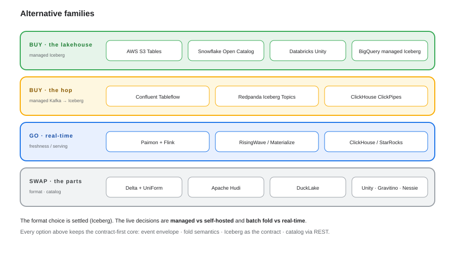
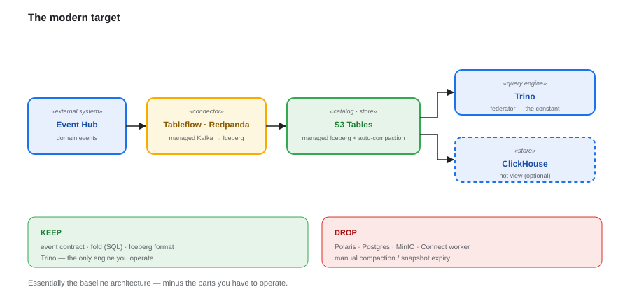

# Alternative Architectures & Modernisation — Options, Build-vs-Buy, TCO

**Companion to `consolidated-architecture.md`, `event-provider-and-freshness.md` and `event-hub-to-trino-options.md`.** The baseline is **Iceberg + a REST catalog + Trino**. This document says *when something else is better*.

---

## 1. Design space

Five axes move independently: **openness/portability · freshness · ops burden · serving latency · ecosystem maturity.** The baseline optimises for *openness*; other options optimise for the others.

## 2. The alternative families



| Family | Examples | Better when | Trade-off |
|---|---|---|---|
| **Buy the lakehouse** | AWS **S3 Tables**, Snowflake **Open Catalog**, Databricks **Unity**, BigQuery managed Iceberg | ops is the constraint | vendor gravity |
| **Buy the hop** | Confluent **Tableflow**, Redpanda **Iceberg Topics**, ClickHouse **ClickPipes** | you want Kafka→Iceberg managed | Kafka-vendor-bound |
| **Go real-time** | **Paimon + Flink**, **RisingWave / Materialize**, **ClickHouse / StarRocks** | freshness or serving latency is the constraint | a second system |
| **Swap the format** | **Delta + UniForm**, **Hudi**, **Paimon**, **DuckLake** | existing ecosystem or CDC/upsert focus | less momentum than Iceberg |
| **Swap the catalog** | **Unity**, **Gravitino**, **Glue/S3 Tables**, **Nessie** | governance or hosting differs | swap only — **Gravitino can also be a metadata plane, not just a catalog** |

## 3. Comparison matrix

| Architecture | Open | Freshness | Ops | Serving | Maturity | Best when |
|---|---|---|---|---|---|---|
| **Iceberg + REST catalog + Trino** *(baseline)* | ★★★ | minutes | medium | 100 ms–s | high | portability is the driver |
| **Managed Iceberg** (S3 Tables / Open Catalog) | ★★★ | minutes | **low** | 100 ms–s | high | open **and** managed |
| **Managed hop** (Tableflow / Redpanda) | ★★★ | seconds→min | **low** | 100 ms–s | high | de-risk the Kafka→Iceberg hop |
| **Databricks / Unity** | ★★ | min→s | low | fast | very high | one platform |
| **Snowflake managed Iceberg** | ★★ | minutes | low | fast | high | Snowflake-centric |
| **Paimon + Flink** | ★★★ | **seconds** | med-high | s | growing | streaming lakehouse |
| **RisingWave / Materialize** | ★★ | **sub-second** | low-med | ms | growing | incremental read models |
| **ClickHouse / StarRocks** | ★★/★★★ | **sub-second** | medium | **ms** | high | real-time serving |
| **DuckLake / DuckDB** | ★★★ | seconds | **very low** | ms (1 node) | early | small / edge |
| **BigQuery managed Iceberg** | ★★ | **seconds** | low | fast | high | GCP-native |

## 4. Build vs buy scorecard

| Criterion | Build (self-host) | Buy (managed) |
|---|---|---|
| Time to first value | days–weeks | hours |
| Ops surface | Polaris + Postgres + MinIO + Connect + maintenance | none |
| Control / portability | **highest** | reduced |
| Cost predictability | your compute + storage | consumption-based, needs guardrails |
| Lock-in | lowest | medium–high |
| Talent / support | you | vendor |
| **Choose when** | portability, residency, or cost at scale dominate | speed, ops, and focus dominate |

## 5. Managed vs self-hosted catalog

| Option | Managed? | Notes |
|---|---|---|
| **Polaris (self-hosted)** | ✗ | full control; you own HA, upgrades, RBAC, backups |
| **Snowflake Open Catalog** | ✓ | managed Polaris |
| **AWS S3 Tables** | ✓ | managed Iceberg + **auto-compaction** + built-in catalog |
| **Databricks Unity** (open-sourced) | ✓/✗ | strong governance; Delta+Iceberg |
| **Glue / Nessie** | ✓/✗ | AWS-native / git-style |

All are **Iceberg-REST compatible**, so this is a **configuration** decision, not a migration.

## 5.1 Metadata and data-quality control plane

The catalog is only one part of governance. Metadata federation, contracts, DQ and API enforcement are a **separate control-plane decision**:

| Option | Metadata across data + APIs | Native DQ | Operational API enforcement | Fit |
|---|---|---|---|---|
| **Gravitino** | Data assets (Kafka/Iceberg/Trino); **no API endpoint entity** | ❌ | ❌ | Lightweight metadata plane (**Hybrid A**) |
| **OpenMetadata** | Tables, topics, **API endpoints**, contracts | ✅ Table DQ + alerts/incidents | ❌ | Unified production plane (**Hybrid B**) |
| **DataHub** | Tables, topics, API endpoints; strongest lineage | ✅ Cloud assertions; Core via GE | ❌ | Lineage-first |
| **Atlas** | Governance/lineage/classification | ❌ | ❌ | Legacy Hadoop estates |
| **GE / Soda** | ❌ (DQ engine only) | ✅ | 🟡 via code | Pair with a catalog |
| **API gate (Spring/APISIX/Kong + OPA)** | ❌ | ❌ | ✅ | **Always required for enforcement** |

**POC decision:** **Hybrid A** — Gravitino + OpenAPI registry + Trino SQL/GE + Iceberg `dq_results` + Spring API gate. **Production evaluation:** **Hybrid B** — OpenMetadata. No product is a policy enforcement point for APIs; the gate is mandatory. Full comparison: [`metadata-and-data-quality-options.md`](metadata-and-data-quality-options.md).

## 6. Storage & licence risk

- Keep the **S3 API** abstraction: the baseline's storage is swappable (S3 · GCS · Azure · MinIO).
- **Validate the object-store edition you deploy.** MinIO's community edition has changed materially, with capability moving toward its commercial edition — pin a version, read the licence, and keep an exit (S3-compatible alternatives: Ceph RGW, Dell ECS, Cloudian, StorageGRID).
- Prefer **managed storage** (S3 / GCS / ADLS / S3 Tables) where residency allows.

## 7. TCO shape (drivers, not prices)

| Option | Cost drivers |
|---|---|
| Iceberg + Trino (self-hosted) | object storage + compute + **compaction/maintenance** + catalog ops |
| Managed Iceberg | storage + query/scan + auto-compaction (bundled) |
| Managed hop (Tableflow / Redpanda) | throughput + storage |
| ClickHouse (hot view) | **a second copy of the data** + cluster ops |
| BigQuery / Snowflake | query bytes/slots + streaming ingest + storage |
| DuckLake / DuckDB | storage only (single node) |

> Rule of thumb: **every store you add multiplies data and ops.** The baseline trades two systems for portability; the managed options trade portability for zero ops.

## 8. The modern target



```
Event Hub ─▶ Tableflow / Redpanda   (managed hop)
          ─▶ S3 Tables              (managed Iceberg + auto-compaction)
          ─▶ Trino (federator) + ClickHouse (hot view)
```

You **keep**: the event contract, the fold (in SQL), and Trino. You **drop**: Polaris, Postgres, MinIO, the Connect worker, and the maintenance gap.

## 9. What to keep regardless

The **contract-first core** is independent of every option above: the event envelope, the fold semantics (`seq > version`), **table format as the contract** (Iceberg), **catalog via REST**, and **config-defined (codeless) realisation**.

## 10. Verdict

- **The format choice is settled** (Iceberg). Switching formats buys little.
- **The live decisions are:** managed vs self-hosted, and **batch fold vs real-time**.
- **Biggest single win:** adopt **managed Iceberg + a managed hop** — it is essentially this architecture minus the parts you operate.
- **Biggest single constraint:** the *hot view* adds a second copy of the data — measure divergence (`05-aggregation-bake-off.md`).
