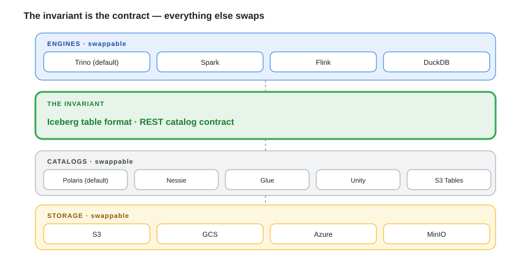
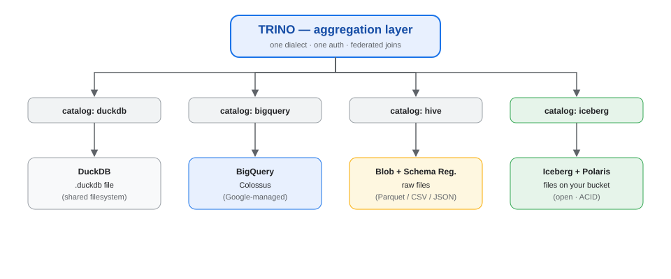
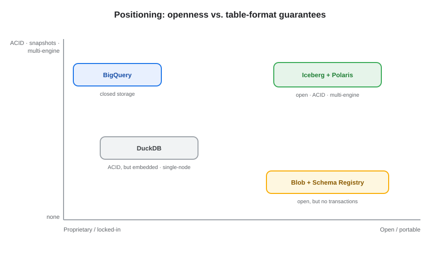
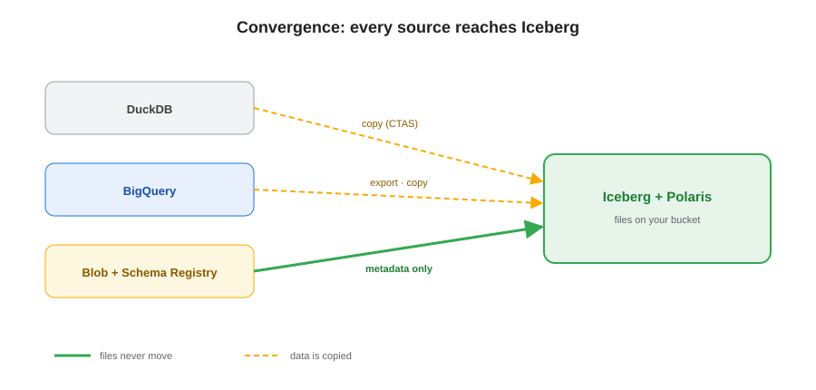
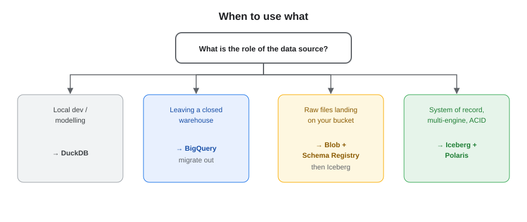
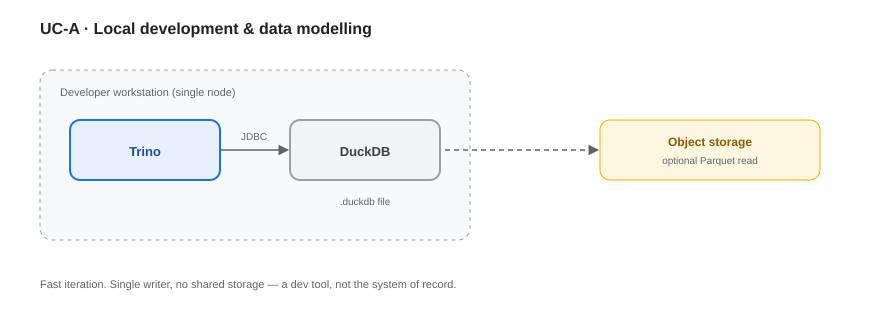
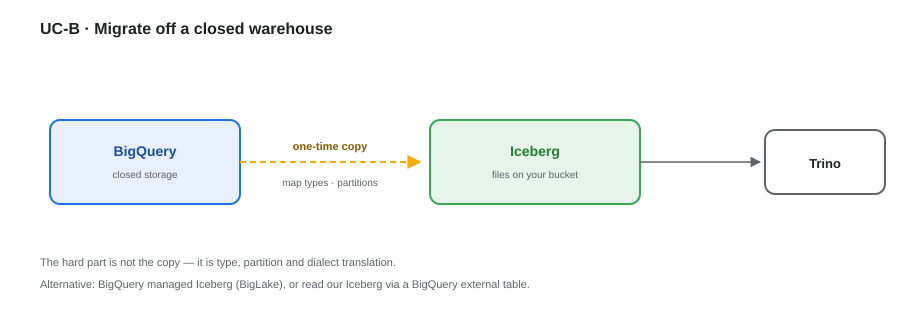
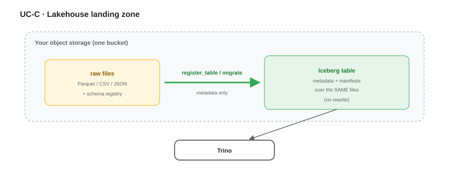
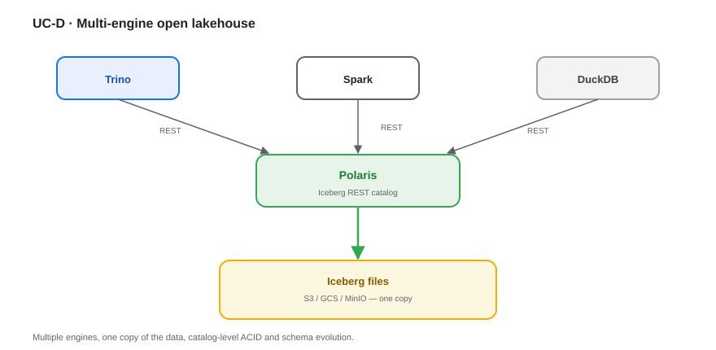

# Trino over Four Data Sources — Consolidated Architecture View

**The invariant is the open table-format + REST-catalog contract (Iceberg + a REST catalog). Trino is the default query engine.** The four "data sources" are not four architectures — they are **one target (Iceberg) plus three on-ramps / legacy roles**.

---

## 1. Architecture at a glance

One Trino cluster mounts all four as catalogs — `duckdb`, `bigquery`, `hive`, `iceberg`. Because they are catalogs, Trino gives federated joins across sources and staged, table-by-table migration with a single SQL dialect.

## 2. The four options

| | **1. DuckDB** | **2. BigQuery** | **3. Blob + Schema Registry** | **4. Iceberg** |
|---|---|---|---|---|
| Storage | Local `.duckdb` file (shared FS) | Google-managed (closed) | Your bucket (raw files) | Your bucket (S3/GCS/Azure/MinIO) |
| Catalog | Embedded in file | BigQuery datasets | Hive Metastore / Glue + schema registry | Iceberg REST catalog (Polaris) |
| ACID / snapshots | Local MVCC, single-writer | Full + time travel | None | Full + time travel |
| Multi-engine | ~None | Limited | Yes (any file reader) | Best-in-class |
| Scale-out | Poor (JDBC, single file) | Excellent | Good | Good |
| Ops effort | Low, fragile at scale | Low (managed) | High | Medium |
| Lock-in | Medium | High | Low | Lowest |
| **Best role** | Local dev + data gen | Migration source | Landing / raw zone | **System of record** |

> **Note:** DuckDB is an **engine**, not a system of record — it appears here only because Trino can mount it as a catalog. Keep "where the bytes rest" (storage) separate from "what queries it" (engines).

## 3. Positioning

Only Iceberg is both open and fully transactional. BigQuery is transactional but closed; blob storage is open but non-transactional; DuckDB is transactional but embedded and single-node.

## 4. Convergence to Iceberg

Blob → Iceberg is **metadata-only** (files never move) — but *only* for well-formed Parquet with Iceberg-compatible partitioning; raw JSON/CSV must be rewritten. BigQuery → Iceberg and DuckDB → Iceberg are **copies**. Landing raw data as Parquet on your own bucket makes the migration nearly free.

## 5. When to use what

- **Local dev / modelling** → DuckDB
- **Leaving a closed warehouse** → BigQuery (as a migration source)
- **Raw files landing on your bucket** → Blob + Schema Registry (then Iceberg)
- **System of record, multi-engine, ACID** → Iceberg + Polaris

## 6. Use cases

### UC-A · Local development & data modelling

Single node, single writer, fast iteration. DuckDB sits beside a local Trino — a dev tool, not shared storage.

### UC-B · Migrate off a closed warehouse

BigQuery tables are copied once into Iceberg. The hard part is type, partition and dialect translation.

### UC-C · Lakehouse landing zone

Raw Parquet is registered / migrated into an Iceberg table **in the same bucket** — files never move. The cheapest possible path.

### UC-D · Multi-engine open lakehouse

Iceberg + Polaris serves Trino, Spark and DuckDB from one copy of the data, with catalog-level ACID.

## 7. Non-goals

- **Point lookups / OLTP** — sub-100 ms key access belongs in a serving or operational store, not Iceberg.
- **Streaming joins on the critical path** — Iceberg is snapshot-at-a-time; real-time logic lives in a stream engine.
- **Everything in Iceberg** — hot real-time serving deliberately stays outside the lakehouse.
- **Multiple writers per table** — one owning writer per table; concurrent writers are the exception, not the default.

## 8. Operational responsibilities

| Option | What you run | Ongoing work |
|---|---|---|
| **Iceberg + Polaris** | catalog service + object storage | compaction, snapshot expiry, catalog upgrades |
| **Blob + Schema Registry** | metastore + registry | small-file/partition gardening, schema governance |
| **BigQuery** | nothing (managed) | query/slot cost control |
| **DuckDB** | nothing (local) | none (dev only) |

## 9. Portability hedge

The contract — **Iceberg + a REST catalog** — is what makes the stack portable, not any single product:

- **Catalog:** any Iceberg REST catalog (Polaris, Nessie, Glue, Unity, S3 Tables) can replace another.
- **Storage:** S3 / GCS / Azure / MinIO differ only by connector properties.
- **Engine:** Trino, Spark, Flink and DuckDB read the same files.

No layer is a one-way door; each is swapped by **configuration**.

### 9.1 Optional control plane

The data-plane contract above does not include metadata governance, DQ or API enforcement. Those are a **separate control-plane decision**:

- **Gravitino** federates Kafka/Iceberg/Trino metadata without copying it; it does **not** model API endpoints, execute DQ or enforce API responses.
- **Great Expectations / Trino SQL** execute DQ; **Iceberg** stores the evidence.
- **The operational API gate** is the only policy enforcement point; no metadata/DQ product blocks API responses natively.

POC v2 adopts **Hybrid A** (Gravitino + OpenAPI registry + Trino SQL/GE + Spring API gate). Production evaluation is **Hybrid B** (OpenMetadata). See [`metadata-and-data-quality-options.md`](metadata-and-data-quality-options.md) and [`../poc/docs/06-metadata-and-dq.md`](../poc/docs/06-metadata-and-dq.md).

## 10. Trends watch list

| Trend | Why it matters |
|---|---|
| **Iceberg v3** (deletion vectors, variant types) | cuts merge-on-read cost; enables JSON/AI payloads |
| **Managed Iceberg** (S3 Tables, Snowflake Open Catalog, Unity) | offloads catalog + compaction |
| **Format interop** (Apache XTable, Delta UniForm) | reduces table-format lock-in |
| **DuckLake / DuckDB Iceberg writes** | DuckDB graduates from dev tool to a lightweight lakehouse engine |
| **Streaming SQL DBs** (RisingWave, Materialize) | collapse the streaming fold into declarative SQL |
| **Data contracts** | the event schema as a formal, enforced contract |
| **Trino direction** (Lakehouse connector, OpenAPI/MCP integrations) | future REST-style ingestion without landing |

## 11. See also

- [`alternative-architectures.md`](alternative-architectures.md) — when something else is better, build-vs-buy, TCO shape.
- [`decisions.md`](decisions.md) — the consolidated decision log (accepted + open).
