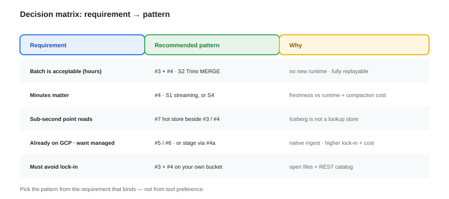
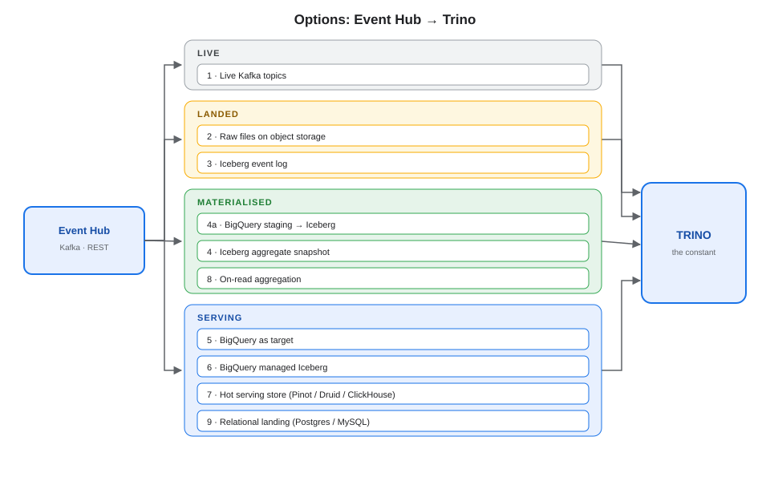
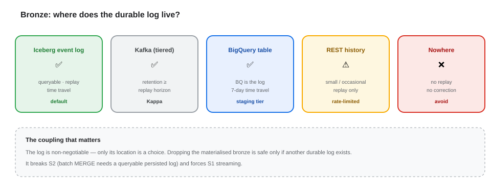
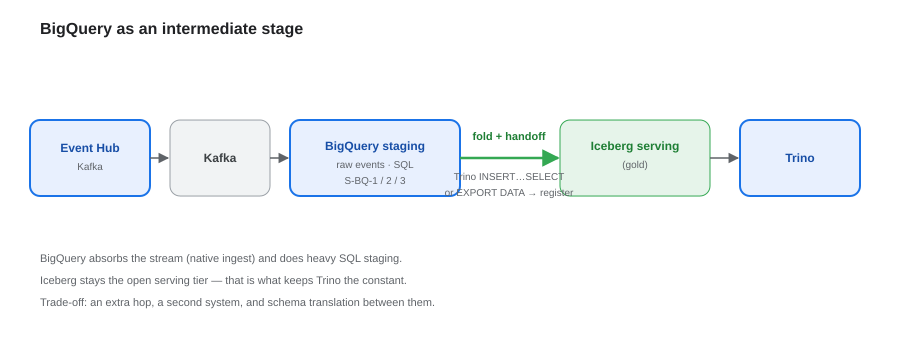
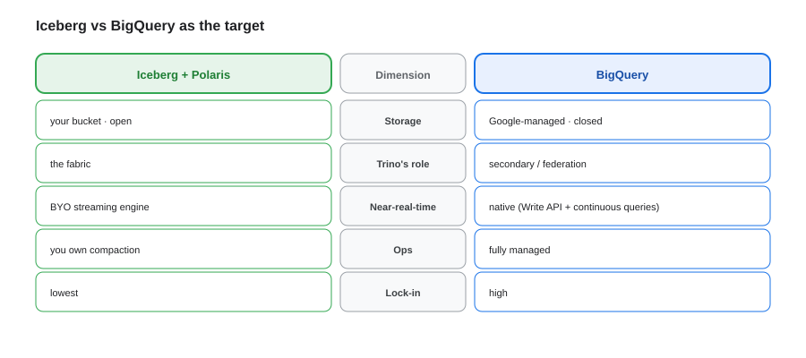
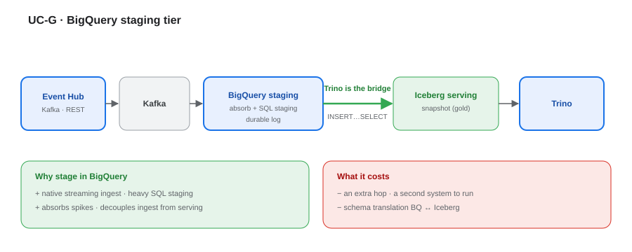

# Event Hub → Trino — Integration Options, Bronze & the BigQuery Stage

**The invariant is the open table-format + REST-catalog contract; every option ends in a Trino catalog — the real choice is where the bytes rest.** Which option you pick should follow the **decision matrix**, not preference.

---

## 1. Architecture at a glance

Event Hub emits **Kafka** (queryable live through a connector) and **REST** (not queryable — Trino has no generic REST connector, so REST data must be landed or wrapped).

## 2. The four families

| Family | Mechanism | Freshness |
|---|---|---|
| **Live** | Kafka topic queried directly | live |
| **Landed** | raw files on object storage | minutes |
| **Materialised** | event log + aggregate snapshot | schedule → seconds |
| **Serving** | hot store for sub-second reads | sub-second |

## 3. The options

| # | Option | Path from Event Hub | Trino connector | Freshness |
|---|---|---|---|---|
| 1 | Live topics | Kafka as-is | `kafka` (+ SR) | live |
| 2 | Raw files on object storage | sink / puller → Parquet | `hive`, `delta_lake`, `hudi` | minutes |
| 3 | Iceberg event log | sink → Iceberg | `iceberg` | commit cadence |
| 4a | **BigQuery staging → Iceberg** | Kafka → BQ → fold → Iceberg | `iceberg` (+ `bigquery`) | BQ ingest + commit |
| 4 | Iceberg aggregate snapshot | fold S1/S2 → Iceberg | `iceberg` | schedule / commit |
| 5 | BigQuery as target | Kafka → BQ | `bigquery` | seconds |
| 6 | BigQuery managed Iceberg | BQ writes Iceberg to GCS | `iceberg` REST | ~commit |
| 7 | Hot serving store | Kafka → Pinot / Druid / ClickHouse | `pinot`, `druid`, `clickhouse` | sub-second |
| 8 | On-read aggregation | aggregate in SQL | any / Iceberg MV | query-time |
| 9 | Relational landing | consumer → Postgres / MySQL | `postgresql`, `jdbc` | milliseconds |

**Cost shape:** every hop is paid for — Iceberg = storage + your compute + compaction; BigQuery = storage + query bytes + streaming inserts (+ dedicated slots for continuous queries). Options **4a, 5 and 6** therefore carry **two** cost centres and must justify the second one.

## 4. Two shapes to pair

| You want in Trino | Raw events path | Snapshot path |
|---|---|---|
| Raw events, live | **#1** | — |
| Raw events, historical | **#2 → #3** | — |
| Domain read model (batch) | **#3** | **#4** (S2 `MERGE`) |
| Domain read model (near-real-time) | **#3** | **#4** (S1) or **#5** |
| Sub-second reads | **#3** | **#7** |

## 5. Bronze — can it be removed?

The log is non-negotiable; only its location is a choice.

| Log lives in | Verdict |
|---|---|
| Iceberg event log (object storage) | ✅ default — queryable, replayable, time travel |
| Kafka (tiered storage) | ✅ Kappa, if retention ≥ replay horizon |
| BigQuery staging table | ✅ BQ is the log (bounded by its time-travel window) |
| Event Hub REST history | ⚠️ small / occasional replay only |
| Nowhere | ❌ loses "snapshots are disposable" |

Removing the materialised Iceberg bronze is safe **only if** another durable log exists — and it **breaks S2** (batch `MERGE` needs a queryable persisted log), forcing you into streaming.

## 6. BigQuery as an intermediate stage

BigQuery becomes the **staging tier**; Iceberg stays the **open serving tier**.

| Placement | Pattern | Handoff to Iceberg |
|---|---|---|
| **S-BQ-1** | BQ as bronze; Iceberg holds the snapshot | Trino `INSERT…SELECT`, or `EXPORT DATA` |
| **S-BQ-2** | events in Iceberg; BQ transforms | BQ writes back (managed) |
| **S-BQ-3** | BQ managed Iceberg | none — BQ writes Iceberg directly |

- **Trino as the bridge** (`INSERT INTO iceberg… SELECT … FROM bigquery…`) keeps Trino central with no external ETL.
- `EXPORT DATA` → GCS Parquet → `register_table` / migrate is the batch alternative.

## 7. Iceberg vs BigQuery as the target

| Dimension | Iceberg + Polaris | BigQuery |
|---|---|---|
| Storage | your bucket, open | Google-managed (closed) |
| Trino's role | the fabric | secondary |
| Near-real-time | BYO streaming engine | native (Storage Write API, continuous queries) |
| Ops | you own compaction | fully managed |
| Lock-in | lowest | high |

## 8. When to use what

- Explore raw events now → **#1**
- Serve the read model, cheapest → **#3 + #4** (S2)
- Near-real-time → **#4** (S1), **#5**, or the intermediate **#4a**
- Sub-second → **#7**
- Already on GCP / want managed ingest → **#5 / #6**, or stage via **#4a**
- REST-sourced data → land it (**#2 / #3**) — there is no direct connector

## 9. Use cases

### UC-G · BigQuery staging tier

Event Hub → Kafka → BigQuery absorbs the stream and does heavy SQL staging; Trino bridges to Iceberg for the serving read model. Adds a hop, but decouples ingest from serving.

### UC-H · Kappa — no materialised bronze

Drop the Iceberg bronze and let Kafka be the log; fold straight to the snapshot. Cheaper, but replay is bounded by Kafka retention and S2 is no longer available.

## 10. Decision summary

- **Every option terminates in a Trino catalog** — the choice is where the bytes rest.
- **REST needs landing**; only Kafka is queryable live.
- **Bronze can go only if another durable log exists** — and it forces streaming.
- **BigQuery as an intermediate** buys native ingest and staging, at the cost of a hop and a second system.
- **Keep Iceberg as the serving tier** — that is what keeps Trino the constant.
