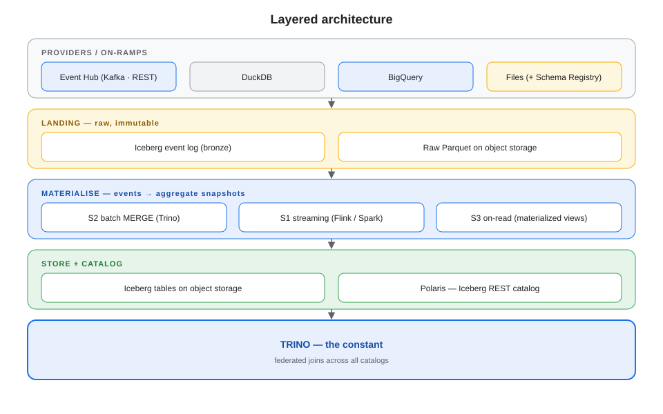
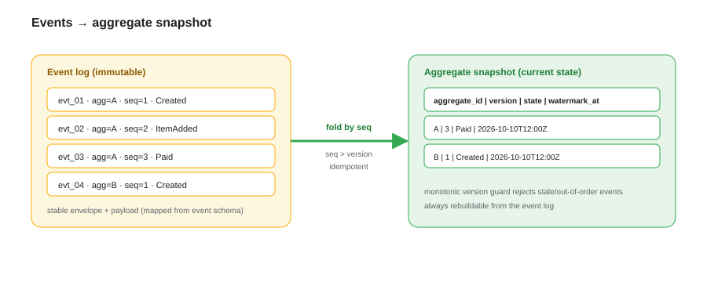
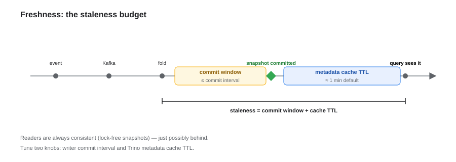
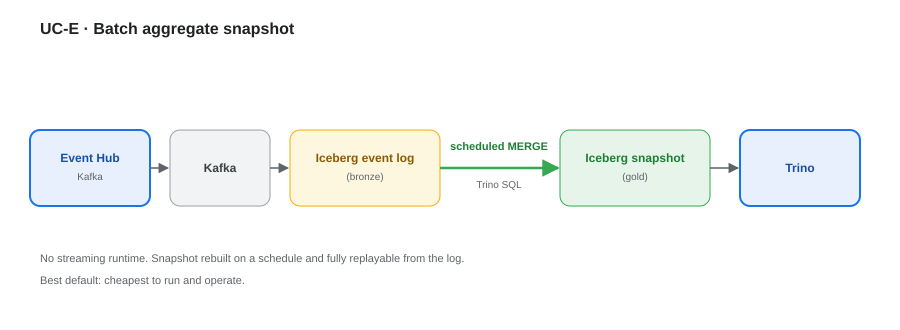
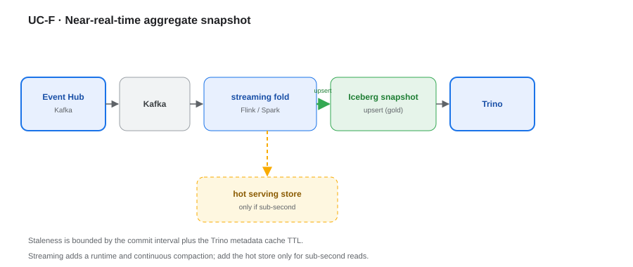

# Event Hub Provider, Aggregation & Freshness — Consolidated Architecture View

**The invariant is the open Iceberg + REST-catalog contract; Trino is the default engine.** Everything else is a provider or an on-ramp — and freshness (batch → near-real-time) is a **configuration choice, not a re-architecture**.

---

## 1. Architecture at a glance



Providers feed a landing zone; events are folded into aggregate snapshots; everything lands in Iceberg on object storage, catalogued by Polaris and served by Trino.

## 2. Where Event Hub sits

It is a **fifth, push-based on-ramp** into the same convergence — not a competing architecture.

| Event Hub element | Maps to |
|---|---|
| Kafka event stream | Blob + Schema Registry on-ramp (push) |
| Aggregate snapshot | Iceberg system of record |
| REST API | Backfill / reconciliation |

## 3. Event Hub — two surfaces

| | **Kafka** | **REST API** |
|---|---|---|
| Model | Push, ordered per partition | Pull, request/response |
| Strength | Throughput, low latency, replay | Backfill, gap-repair, lookups |
| Weakness | Needs retention / offsets | Rate limits, no ordering |
| **Role** | Primary ingestion | Backfill / reconciliation |

## 4. Two data shapes

| | Event log | Aggregate snapshot |
|---|---|---|
| Nature | Immutable, append-only | Derived, current state |
| Key | `aggregate_id`, `seq` | `aggregate_id` |
| Role | **Source of truth** (bronze) | **Read model** (gold) |

```sql
events (event_id, aggregate_id, aggregate_type, event_type,
        schema_version, seq, occurred_at, payload)
snapshot_<aggregate> (aggregate_id, version, <domain attributes>,
        last_event_at, watermark_at)
```

## 5. Aggregation strategies

| Strategy | Mechanism | Freshness | New runtime |
|---|---|---|---|
| **S1** streaming fold | Flink / Spark → Iceberg upsert | seconds → min | Yes |
| **S2** micro-batch MERGE | Trino `MERGE` on schedule | min → hr | **None** |
| **S3** on-read | Iceberg materialized views | on refresh | None |
| **S4** lambda-lite | S1 hot + S2 reconcile | seconds → min | Yes |

**Default: S2** — no new runtime, and the event log stays the source of truth.

## 6. Materialisation flow



Envelope columns stay stable while `payload` evolves; a monotonic `version` guard rejects stale or out-of-order events, so the snapshot is always rebuildable from the log.

## 7. Freshness model



Staleness ≈ **ingest lag + writer commit interval + Trino metadata cache TTL + query planning**. Readers stay consistent (lock-free snapshots) — just possibly behind.

> Cache defaults are Trino-version-specific — **measure** them for your build rather than assuming ~1 min. On wide or large tables, planning/execution often dominates perceived staleness.

| Tier | Achievable | Mechanism |
|---|---|---|
| ~1–5 min | ✅ default | S2 or short-interval streaming |
| ~10–60 s | ✅ with tuning | streaming + short commit + short metadata cache |
| ~1–5 s | ⚠️ costly | very short commits, heavy compaction |
| sub-second | ❌ | hot serving tier beside Iceberg |

## 8. Batch vs near-real-time

| | Batch (S2) | Near-real-time (S1/S4) |
|---|---|---|
| Runtime | None (Trino) | Streaming engine + state |
| Freshness floor | The schedule | Iceberg commit cadence |
| Exactly-once | Idempotent `MERGE` | Checkpoint + 2PC sink |
| Maintenance | Light | Continuous compaction / expiry |
| Constants | **Trino · Iceberg · Polaris · event log as truth** | same |

## 9. When to use what

- Event stream / domain events → **Kafka** (primary), **REST** (backfill)
- Aggregate snapshots → **S2** by default; **S1/S4** only for hot aggregates
- Cheap roll-ups → **S3** materialized views
- Sub-second access → **hot serving tier** (the one deliberate exception)

## 10. Use cases

### UC-E · Batch aggregate snapshot



Event Hub → Kafka lands raw events in Iceberg; a scheduled Trino `MERGE` builds the snapshot. No streaming runtime, fully replayable.

### UC-F · Near-real-time aggregate snapshot



A streaming fold upserts the same snapshot contract; staleness is bounded by the commit interval plus the metadata cache TTL. A hot store is added only if sub-second reads are required.

## 11. Contract & schema

The event schema **is** the domain-model contract — treat it as such.

| Concern | Rule |
|---|---|
| Compatibility | Registry-enforced (BACKWARD or FULL); consumers never break |
| Mapping | stable envelope + `payload` → typed columns; nested types map 1:1 where possible |
| Evolution | additive only; new fields default null; breaking changes → new `schema_version` |
| Engine parity | one Iceberg schema readable by every engine (Trino, Spark, DuckDB) |
| Format | adopt Iceberg v3 features (deletion vectors, variant) once engine support is GA |

## 12. Decision summary

- **Event Hub is a provider**, not an architecture — it feeds the same convergence to Iceberg.
- **Batch-first (S2)** for snapshots; escalate to streaming only on a real freshness trigger.
- **Freshness is configuration** — the commit interval and metadata cache TTL set the floor.
- **Trino stays the constant** until sub-second point lookups force a serving tier.
