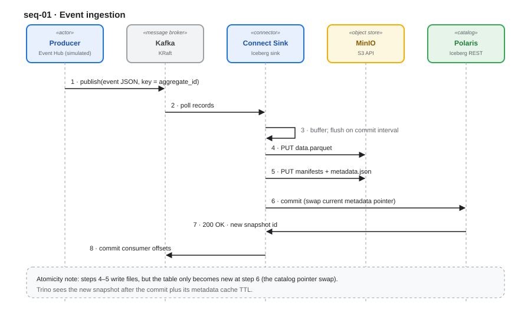
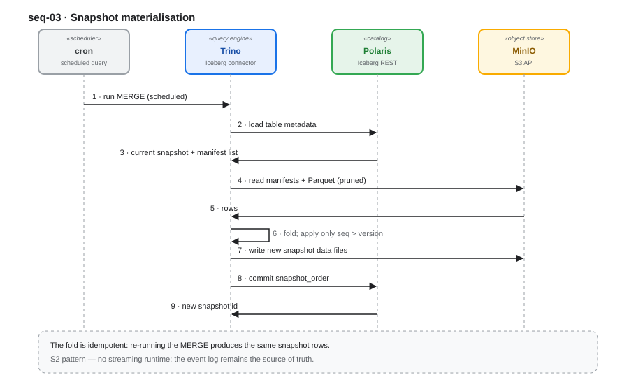
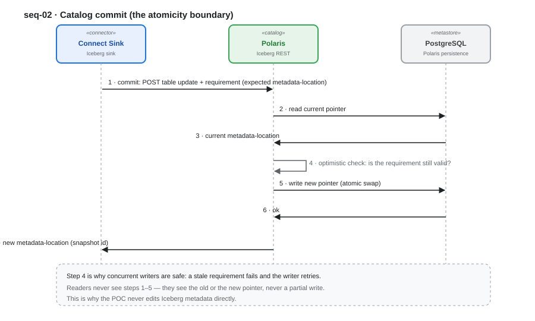
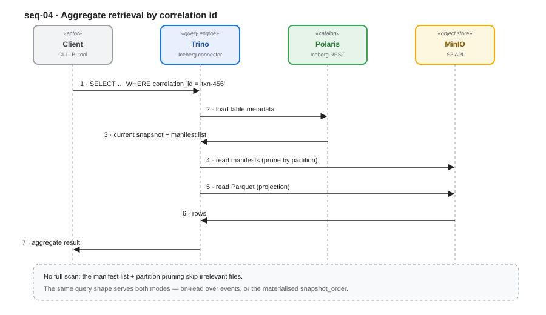
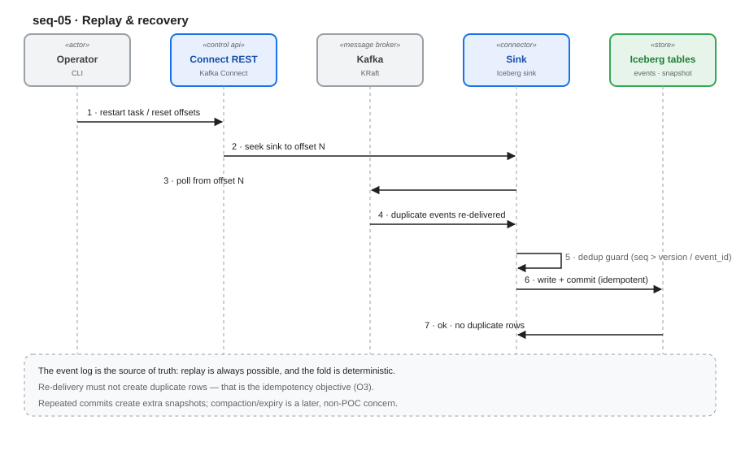

# Architecture — Event Hub → Iceberg → Trino POC

**Scope: architecture and key designs.** POC v1 covers the data path; **POC v2** adds a metadata/contract/DQ control plane (see [`06-metadata-and-dq.md`](06-metadata-and-dq.md)). HA, SSO, multi-engine, cost and compaction automation remain out of scope.

---

## 1. Context & scope

One vertical slice: **domain events → open table format → REST catalog → SQL query.**

```
Event Hub (Kafka) ─▶ Connect Iceberg sink ─▶ MinIO (Parquet + Iceberg metadata) ─▶ Polaris (REST catalog) ─▶ Trino
```

In scope: ingestion, storage layout, commit semantics, catalog interaction, retrieval.
Out of scope: HA, SSO, multi-engine, cost, compaction automation.

## 2. Contracts & bindings (layering by abstraction)

The **data path** is codeless, so the layers are **contract boundaries, not code modules**. Substitutability comes from **open protocols**, not interfaces in code. POC v2 adds a bounded code carve-out for the operational API and GE service (D22).


| Layer (directory) | The stable contract | Bound by (configuration) | Substitutable via |
|---|---|---|---|
| **Domain** (`domain/`) | event envelope + invariants | — (specification) | any producer honouring it |
| **Capabilities** (`application/`) | publish · store · catalog · query · fold | capability definitions | — |
| **Bindings** (`adapters/`) | which product implements each capability | connector JSON, properties, SQL | Iceberg REST · S3 API · SQL · Kafka |
| **Runtime** (`infrastructure/`) | the deployed components | compose, image tags | any conforming product |

**Artefact-reference rule** (the codeless analogue of the dependency rule): an artefact may reference a *contract*, never another artefact's internals. Runtime configures bindings; bindings provide capabilities; capabilities rely on the event contract.

> **No application code is written in the data path.** The layers are expressed as *contracts, configuration and SQL*; see §14. The `domain/`, `application/` and `adapters/` folders are **documentation-only**. POC v2 introduces **two bounded code homes**: `operational-api/` (Spring gate) and `dq/gx-service/` (Python GE). They are bindings of the `enforce` and `observe` capabilities, not a rewrite of the data path (**D22**).

> **Diagram stereotypes:** the layer diagram labels each band `«contract»` · `«capability»` · `«binding»` · `«runtime»`; every sequence-diagram participant is labelled with its **stereotype and product** (legend in §3).

### 2.1 Control-plane contracts and bindings (POC v2)

| Layer | Stable contract | Bound by (product) | Realised as |
|---|---|---|---|
| **Govern** | assets, tags, policies, contracts | Apache Gravitino + OpenAPI registry | Gravitino bootstrap + `metadata/api/openapi.yaml` |
| **Observe** | DQ checks and evidence | Trino SQL + Great Expectations | `sql/04_*.sql` + `dq/gx-service/` |
| **Enforce** | API decision (allow / warn / block) | Spring Boot `ApiDqGate` | `operational-api/` |
| **Evidence** | DQ history | Iceberg `dq_results` | Trino DDL + inserts |
| **Transport** | async DQ samples/results | Kafka | `api-dq-samples`, `dq-results` |

The control plane is **additive**: it does not replace Polaris, Trino, the Connect sink or the event contract.

## 3. Runtime topology



| Component | Stereotype | Role | Product (third-party, reused) |
|---|---|---|---|
| Event Hub | `«external system»` | publishes domain events (upstream) | Event Hub (simulated by `kcat` / Connect source) |
| Kafka (KRaft) | `«message broker»` | event transport | Apache Kafka |
| Kafka Connect + Iceberg sink | `«connector»` | Kafka → Iceberg writer + committer | `org.apache.iceberg.connect.IcebergSinkConnector` |
| MinIO | `«object store»` | data + metadata files (S3 API) | MinIO |
| Polaris | `«catalog»` | atomic pointer swap | Apache Polaris (REST) |
| PostgreSQL | `«metastore»` | catalog persistence | PostgreSQL |
| Trino | `«query engine»` | query + materialisation | Trino (Iceberg connector) |
| Scheduler | `«scheduler»` | triggers the periodic fold | cron / Trino scheduled query |

**Stereotype legend** (used across the diagrams):

| Stereotype | Meaning | Product in the POC |
|---|---|---|
| `«external system»` | outside our control | Event Hub |
| `«actor»` | human / CLI caller | Operator · Client · `kcat` |
| `«message broker»` | event transport | Apache Kafka |
| `«connector»` | Kafka ↔ table binding | Iceberg Kafka Connect sink |
| `«object store»` | blob storage (S3 API) | MinIO |
| `«catalog»` | metadata pointer store | Apache Polaris (REST) |
| `«metastore»` | catalog persistence | PostgreSQL |
| `«query engine»` | SQL execution | Trino |
| `«scheduler»` | periodic trigger | cron / Trino scheduled query |
| `«control api»` | management surface | Kafka Connect REST API |
| `«store»` | logical data set | Iceberg tables (`events`, `snapshot_order`) |
| `«metadata lake»` | federated metadata plane | Apache Gravitino |
| `«contract»` | API contract source | OpenAPI registry |
| `«dq engine»` | DQ execution | Great Expectations |
| `«api / PEP»` | API + policy enforcement | Spring Boot |
| `«cache»` | latest DQ status | Caffeine |
| `«transport»` | async DQ samples/results | Kafka |
| `«evidence»` | DQ history | Iceberg `dq_results` |

> **Event production:** for the POC, events are *simulated* (Event Hub is assumed upstream) using either a Kafka Connect **source connector** or a CLI producer (`kcat`). No producer application is written.

> **Scheduler:** the periodic snapshot fold (§5) is driven by `cron` or a Trino scheduled query — not by code.

### 3.1 Control-plane runtime topology (POC v2)

| Component | Stereotype | Role | Product |
|---|---|---|---|
| Gravitino | `«metadata lake»` | federated metadata, tags/policies/statistics/audit | Apache Gravitino |
| OpenAPI registry | `«contract»` | API contract source | Git / OpenAPI 3.1 |
| `gx-dq-service` | `«dq engine»` | API response DQ | Great Expectations (Python) |
| `operational-api` | `«api / PEP»` | serve orders, enforce DQ | Spring Boot |
| `dq_results` | `«evidence»` | DQ history | Iceberg / Trino |
| DQ status cache | `«cache»` | latest status per asset/contract | Caffeine (Redis optional) |
| `api-dq-samples` / `dq-results` | `«transport»` | async DQ flow | Kafka |

The data path remains:

```text
Event Hub ─▶ Kafka ─▶ Connect Iceberg sink ─▶ MinIO ─▶ Polaris ─▶ Trino
```

Gravitino is **not** in the data path; it federates metadata from Kafka and Polaris.

## 4. Key design — event contract

Kafka topic `domain-events`; **message key = `aggregate_id`** (per-key ordering).

```json
{ "event_id":"…", "event_type":"OrderCreated", "schema_version":1,
  "aggregate_id":"order-123", "correlation_id":"txn-456", "seq":1,
  "occurred_at":"2026-10-10T12:00:00Z", "payload": { "…" : "domain model" } }
```

- `aggregate_id` — the **fold key** (one entity).
- `correlation_id` — stitches events **across** aggregates (one business transaction).
- `seq` — monotonic per aggregate; makes the fold idempotent.
- Envelope columns are stable; only `payload` evolves.

## 5. Key design — domain to snapshot



The **aggregate snapshot** is a fold of the event log, keyed by `aggregate_id`.

```sql
events (event_id, event_type, schema_version, aggregate_id, correlation_id,
        seq, occurred_at, payload)
snapshot_order (aggregate_id, correlation_id, version, status, total,
        last_event_at, watermark_at)
```

Rule: apply an event only if `seq > version` (monotonic guard) → deterministic, replayable.

**The fold engine is pluggable** — the snapshot table is the contract, not the engine. Any SQL-capable engine can produce it:

| Engine | Fold expressed as | Codeless | Freshness |
|---|---|---|---|
| **Trino (default, S2)** | SQL `MERGE`, scheduled | ✅ SQL | schedule |
| **Flink SQL** | `INSERT INTO snapshot SELECT … GROUP BY …` | ✅ Flink *SQL* | seconds→min |
| **Spark SQL** | `MERGE INTO` | ✅ SQL | schedule / stream |
| **ksqlDB** | SQL over Kafka → Connect Iceberg sink | ✅ SQL + config | seconds |
| **RisingWave / Materialize** | streaming SQL DB with an Iceberg sink | ✅ SQL | seconds |

Constraint: whichever engine folds, it must **commit through the catalog** and preserve the `seq > version` guard. The POC uses **Trino** (fewest moving parts), driven by a scheduler.

A **hot-view alternative** for the aggregate — ClickHouse materialized views + `ReplacingMergeTree` — and the criteria that decide between it and the Iceberg record are covered in [`05-aggregation-bake-off.md`](05-aggregation-bake-off.md) (objective **G6**).

## 6. Key design — storage & table layout

- Data files: **Parquet**.
- Metadata: Iceberg manifests (Avro) + `metadata.json` (JSON).
- Location: `s3://warehouse/…` on MinIO (path-style).
- Partitioning: `day(occurred_at)` on `events`; `bucket(aggregate_id)` optional on the snapshot.
- **No file layout is hand-authored** — the sink writes it.

## 7. Key design — catalog & commit semantics



The **catalog owns atomicity**. On each commit the sink asks Polaris to swap the table's
current-metadata pointer; readers never see a partial write. This is why the POC never edits
metadata directly — the pointer swap *is* the transaction.

**Storage is outside the transaction.** Files are written to MinIO *first* and are **not**
transactional — object stores provide no cross-file atomicity. The sequence is:

1. write immutable, uniquely-named files to MinIO (data · manifests · `metadata.json`) → **invisible** to readers;
2. **commit** — Polaris swaps the pointer in a single conditional update → *the table becomes new*;
3. readers now resolve the new snapshot.

A crash between (1) and (2) leaves **orphan files**, never a partial read; two concurrent writers
collide on the requirement check and retry (optimistic concurrency). "Atomic" here means a
**single pointer swap** — not ACID across two systems.

## 8. Key design — the sink

Config-driven **binding** (`infrastructure/config/kafka-connect/iceberg-sink.json`):

- `IcebergSinkConnector`, `iceberg.tables.auto-create-enabled=true`, `evolve-schema-enabled=true`.
- REST catalog → Polaris; `S3FileIO` → MinIO.
- `iceberg.control.commit.interval-ms` sets the commit cadence = **the freshness floor**.
- `JsonToMapTransform` maps JSON to typed columns.

**Orchestration is internal to the connector** — a sink *task* writes files; a *committer* performs
the catalog commit; a **control topic** (`iceberg.control.topic`) coordinates tasks. Evidence: tests **T7–T9**.

## 9. Key design — retrieval



Two modes, both keyed by `correlation_id`:

| Mode | Query | Use |
|---|---|---|
| **On-read** | `SELECT … FROM events WHERE correlation_id = ? ORDER BY occurred_at` | audit / ad-hoc |
| **Materialised** | `SELECT … FROM snapshot_order WHERE correlation_id = ?` | serving read model |

## 10. Key design — freshness

`staleness ≈ ingest lag + commit interval + Trino metadata cache TTL + planning`.
Both knobs (commit interval, cache TTL) are measured, not assumed (see `00-goals-and-objectives.md` O1).

## 11. Key design — replay & recovery



The event log is the source of truth: offsets can be reset and events re-ingested; the `seq > version`
guard keeps re-ingestion **idempotent**.

## 12. Capabilities → bindings map

| Capability (contract) | Bound by (product) | Realised as |
|---|---|---|
| publish | Kafka (source connector / `kcat`) | connection config / CLI |
| store | Iceberg Kafka Connect sink | `infrastructure/config/kafka-connect/iceberg-sink.json` |
| catalog | Polaris (Iceberg REST) | catalog config + CLI bootstrap |
| query · fold | Trino | `sql/*.sql` + Trino CLI |
| storage | MinIO (S3 API) | connector properties |
| govern | Gravitino + OpenAPI registry | Gravitino bootstrap, tags/policies, `metadata/api/openapi.yaml`, `asset_catalog` |
| observe | Trino SQL + Great Expectations | `sql/04_*.sql`, `dq/gx-service/` (Kafka async planned) |
| enforce | Spring Boot `ApiDqGate` | `operational-api/`, sync GE, headers (cache/audit planned) |

### 12.1 Control-plane flow (POC v2)

```text
                    ┌──────────────────────────────┐
                    │ Spring operational API (PEP) │
                    │ inline Java validation       │
                    │ ApiDqGate → cache/async/sync │
                    └───────┬───────────┬──────────┘
                            │           │
                  OpenAPI contract      │ Trino SQL
                            │           │
                ┌───────────▼─────┐  ┌──▼─────────────┐
                │ Gravitino +     │  │ Trino          │
                │ OpenAPI registry│  │ dq_results     │
                └───────┬─────────┘  └──▲─────────────┘
                        │               │
                 Kafka/Polaris      Kafka dq-results
                        │               │
                        └──────┬────────┘
                               │
                    ┌──────────▼──────────┐
                    │ gx-dq-service (GE)  │
                    │ API response checks │
                    └─────────────────────┘
```

## 13. Non-goals

POC v1 non-goals: see `00-goals-and-objectives.md` §5. POC v2 non-goals: see §13 of the same document. Point lookups, OLTP, streaming joins and multi-writer tables are explicitly **not** addressed by the data slice.

**Unowned in the POC (not an oversight):** **compaction, snapshot expiry and orphan-file cleanup** belong to Iceberg maintenance and have **no owner** here. They become a scheduled maintenance task (`optimize`, `expire_snapshots`, `remove_orphan_files`) once the slice is proven.

**POC v2 control-plane non-goals:** replacing Polaris; deploying OpenMetadata/DataHub; a Kafka Schema Registry; full cross-system lineage; HA/SSO; data-masking enforcement; full GE on every high-QPS request (POC gate is sync/low-QPS); blocking direct Trino queries.

**POC v2 control-plane limitations:** Gravitino has no API-endpoint entity and no DQ engine; GE is Python-only; Kafka payload schemas stay in the domain contract/Schema Registry; Gravitino statistics are not history; lineage is partial. See [`06-metadata-and-dq.md`](06-metadata-and-dq.md).

## 14. Config-defined (codeless) execution

The **data path** runs **without application code**. Every step is configuration, SQL, or a CLI/REST call. POC v2 adds a bounded code carve-out for the operational API and GE service (D22); see §14.1.

| Step | Realised as | Codeless |
|---|---|---|
| Produce events (simulate Event Hub) | Connect source connector / `kcat` CLI | ✅ |
| Kafka → Iceberg write + commit | connector configuration | ✅ |
| JSON → typed columns | built-in SMTs (`JsonToMapTransform`) | ✅ |
| Catalog bootstrap | Polaris CLI / Management API | ✅ |
| Table DDL | Trino SQL | ✅ |
| Snapshot fold | Trino SQL `MERGE` + scheduler | ✅ |
| Retrieval | Trino CLI + `sql/*.sql` | ✅ |
| Replay | Connect REST API | ✅ |

### 14.1 Code carve-out (POC v2)

**Where code re-enters in POC v2 (deliberate, bounded):**

| Code home | Why code is required | Boundary |
|---|---|---|
| `operational-api/` | HTTP API + DQ enforcement (PEP) | reads Trino, calls GE/cache; no Iceberg writes outside `dq_results` |
| `dq/gx-service/` | GE is Python-only | validates samples; `dq-results` publishing planned; no catalog writes |

The data path still has **no application code**; a custom SMT or REST-only ingestion puller remains out of scope.

> In short: the **data path** is realised as **contract + configuration + SQL**; the **control plane** adds a thin, explicitly bounded API and DQ service.
