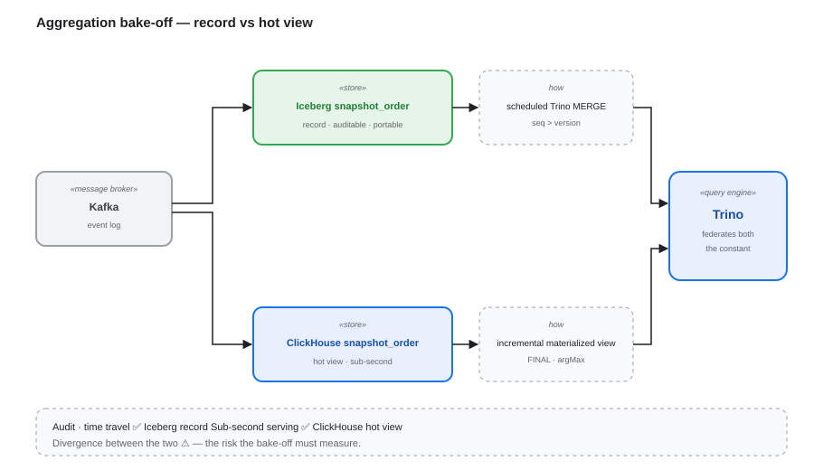

# Aggregation Bake-off — Hot View (ClickHouse) vs Record (Iceberg)

**One question decides it: does the aggregate snapshot need auditability, time travel or snapshot isolation?**

---

## 1. Why this document exists

The aggregate snapshot (`snapshot_order`) can be produced two ways. **The plumbing in both is commodity; the decision is not.** This document frames the comparison so the POC produces a *decision* rather than a demo.

## 2. The decision question

| Requirement | Architecture | PoC needed? |
|---|---|---|
| Sub-second serving, **no audit need** | **ClickHouse alone** | **No — buy it** (ClickPipes + ClickHouse Cloud) |
| Sub-second serving **and** an auditable record | **Iceberg = record, ClickHouse = serving** (two-store) | **Yes** — PoC the *sync* and the divergence |
| The aggregate is a **state machine** | neither — needs a stream processor (Flink) + Iceberg | Yes, but not in ClickHouse |
| **Portability** is the driver | Iceberg + Trino stays the aggregate; ClickHouse optional serving | Only validate the serving tier |

## 3. The two-store pattern

Iceberg is the **record** (auditable, time-travellable, portable); ClickHouse is the **hot view** (sub-second); **Trino federates both**, so the constant survives.

## 4. Scorecard (the bake-off measures this)

| Criterion | Iceberg fold (S2) | ClickHouse MV |
|---|---|---|
| Freshness | schedule (min → hr) | **sub-second** |
| As-of / audit query | ✅ `FOR VERSION AS OF` | ❌ / awkward |
| Idempotent replay | ✅ `seq > version` | ⚠️ `FINAL` / `argMax` |
| Snapshot isolation for readers | ✅ | ✗ (eventual) |
| Portability / multi-engine | ✅ | ✗ |
| Divergence vs the record | n/a | **⚠️ the key risk to measure** |
| Ops + cost | batch + compaction | a second store |

## 5. What this PoC uniquely proves

- **Your fold semantics in a hot store** — latest-wins vs state machine; `seq`/`correlation_id` behaviour; `FINAL` cost.
- **The consistency contract** — how far the hot view may drift, and how it is rebuilt from the log.
- **Measured freshness and cost** for both paths, on your data.
- **The build-vs-buy decision** (objective **G6**).

## 6. Non-goals

- Proving Kafka → ClickHouse materialized views work — commodity; a product with a quickstart.
- Proving ClickHouse is fast — that is the product.
- Replacing the Iceberg record with ClickHouse when auditability is required.

## 7. Outcome

The bake-off resolves to **one of the four rows in §2**, with the divergence measured in §4. That is the POC's deliverable here — not a working demo of either pipeline.
